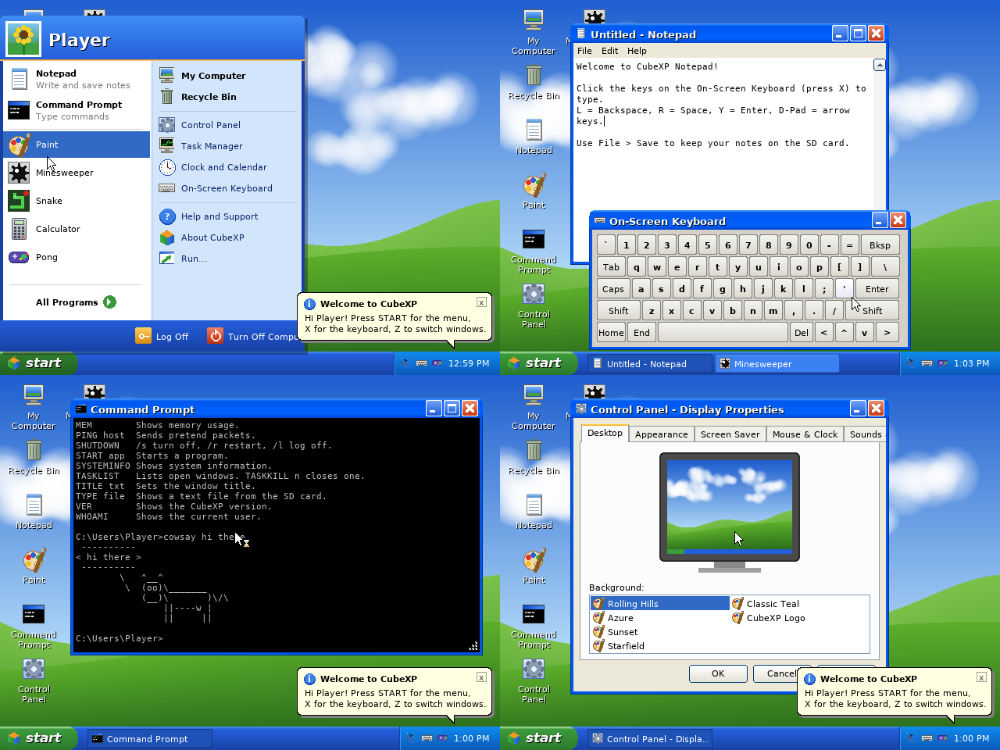

# CubeXP

A Windows XP-style desktop "OS" for the Nintendo GameCube. It runs on real hardware through Swiss and in the Dolphin emulator.



## What's inside

- **Boot screen, login screen and welcome screen**, with an original start-up chime
- **Luna-style desktop**: icons, a taskbar, a green Start button, a system tray with a clock and pop-up notification balloons
- **Window manager**: drag, resize, minimize, maximize, double-click the title bar to maximize, Z to switch windows (like Alt+Tab)
- **Start menu** with All Programs, Log Off and a Turn Off dialog that fades the screen to grey
- **Right-click menus** on the desktop, on icons and on taskbar buttons
- **Screensaver**: a starfield with a bouncing logo
- **Themes**: Blue, Olive Green and Silver. **Wallpapers**: 6 built in, or use your own painting
- **Settings saved to SD card** (SD Gecko / SD2SP2) in `/cubexp`

### Programs

| Program | What it does |
|---|---|
| My Computer | Drives, controller status, SD card browser, system properties |
| Notepad | Word-wrapping editor. Saves and opens `.txt` files on the SD card |
| Paint | 8 tools, 28 colours, flips, invert, save/open BMP, **Set as Background** |
| Calculator | Standard XP calculator with memory keys |
| Command Prompt | 25+ commands (`help`, `dir`, `type`, `calc 2^10`, `color 0a`, `matrix`, `cowsay`, `tasklist`, `shutdown /r`…) |
| Minesweeper | Beginner / Intermediate / 16x16, flags, chording, 7-segment counters |
| Snake, Pong | D-Pad games |
| Control Panel | Wallpaper, theme, screensaver, pointer speed, 12/24h clock, sounds, user name |
| Task Manager | End or switch tasks, CPU and memory graphs |
| Clock and Calendar | Analog clock and a month calendar |
| On-Screen Keyboard | Type with the pointer, into whatever window is active |
| Run…, Help and Support, About, Recycle Bin | |

## Controls

| Button | Action |
|---|---|
| Control Stick | Move the mouse pointer |
| A | Left click (double-click to open) |
| B | Right click |
| START | Start menu |
| X | On-Screen Keyboard |
| Z | Switch windows |
| C-Stick | Scroll |
| D-Pad | Arrow keys, game controls, nudge the pointer |
| L / R / Y | Backspace / Space / Enter (when typing) |

## Running it

**Dolphin:** File > Open > `cubexp.dol`. To let it save, add an SD card adapter in Config > GameCube (Slot A, Slot B or SP1).

**Real GameCube:** copy `cubexp.dol` to your SD card and launch it from Swiss.

## Building

Every push builds automatically with GitHub Actions. Download `cubexp.dol` from the **latest** release, or from the workflow run's artifacts.

To build locally, install devkitPro with `gamecube-dev`, then run `make`.

### PC test harness

`tools/host/build.sh` compiles the whole OS for Linux with a fake platform layer. It runs a script of button presses and saves screenshots, which lets you check the UI without an emulator:

```
./tools/host/build.sh
SCRIPT=myscript.txt ./tools/host/cubexp_host
```

Script commands: `wait N`, `warp X Y`, `tap A`, `hold A`, `release A`, `type text_with_underscores`, `enter`, `launch N`, `closeall`, `shot file.ppm`, `quit`.

## Credits

The UI fonts are generated from DejaVu Sans (`tools/genfont.py`), released under the Bitstream Vera / DejaVu license. CubeXP is a fan homebrew project and is not affiliated with Microsoft or Nintendo.
